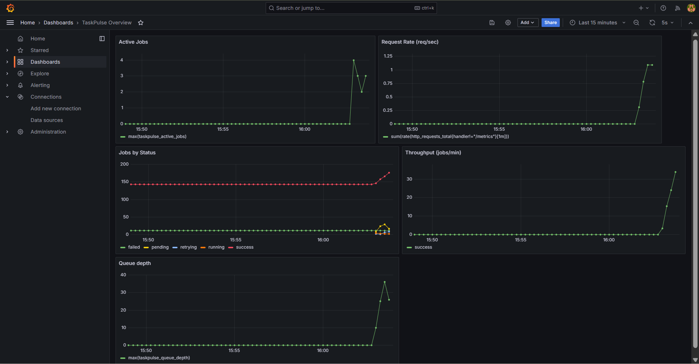

# TaskPulse

Distributed job processing platform with full observability: metrics, logs and traces.

## Stack
FastAPI, Celery, Redis, PostgreSQL, Prometheus, Loki, Grafana Alloy, Tempo, OpenTelemetry, Grafana, Docker Compose

## Features
- Submit background jobs over HTTP (202 Accepted)
- Celery workers with retries and exponential backoff (2s, 4s, 8s)
- Job status tracking in PostgreSQL (pending, running, retrying, success, failed)
- Manual retry for failed jobs
- Per-client rate limiting (HTTP 429 with Retry-After)
- Queue backpressure (HTTP 503 when the queue is full)
- Prometheus metrics and a Grafana dashboard (queue depth, throughput, active jobs)
- Structured JSON logs shipped to Loki and searchable in Grafana
- Distributed tracing with OpenTelemetry and Tempo (API, queue, worker and database in one trace)

## Architecture
```
Client --> FastAPI (rate limit, save job) --> Redis queue --> Celery worker
                |                                                  |
                +------------------> PostgreSQL <------------------+

Metrics: API :8000/metrics and worker :8001/metrics --> Prometheus --> Grafana
Logs:    container stdout (JSON) --> Grafana Alloy --> Loki ------> Grafana
Traces:  OpenTelemetry (API and worker) --> Tempo ----------------> Grafana
```

## API
| Method | Endpoint | Purpose |
|---|---|---|
| POST | /jobs | Submit a job (response includes its `trace_id`) |
| GET | /jobs | List jobs, filter by status |
| GET | /jobs/{id} | Job details |
| POST | /jobs/{id}/retry | Retry a failed job |
| GET | /health | Health check |
| GET | /metrics | Prometheus metrics |

Job types: `generate_report`, `send_email`, `resize_image`.

## Rate limits
| Scope | Default | Environment variable |
|---|---|---|
| Submit jobs | 30 per minute per client | `RATE_LIMIT_SUBMIT` |
| Read jobs | 300 per minute per client | `RATE_LIMIT_READ` |
| Retry jobs | 10 per minute per client | `RATE_LIMIT_RETRY` |
| Queue length before HTTP 503 | 500 | `MAX_QUEUE_DEPTH` |

Clients are identified by the `X-API-Key` header, or by IP address if there is no header.

## Run
```
copy .env.example .env
docker compose up --build -d
```
(On Mac/Linux use `cp` instead of `copy`.)

Open http://localhost:8000/docs and submit a job.

## Tests
```
docker compose exec api pytest -q
```

## Observability

### Metrics
Prometheus scrapes metrics from the API (`:8000/metrics`) and the worker (`:8001/metrics`).
The Grafana dashboard shows queue depth, active jobs, request rate, throughput and jobs by status.



### Logs
Structured JSON logs are shipped to Loki by Grafana Alloy and searched in Grafana Explore.
This is the full history of one job: submitted, failed three times with exponential backoff, then succeeded.


Useful queries:
```
{service="worker"} | json | level="WARNING"
{service=~"api|worker"} |= "JOB-ID"
```

### Traces
OpenTelemetry traces go to Tempo. One trace follows a job from the API, through the Redis queue, into the worker and the database.
The API answers in about 57 ms while the job runs in the background, and the trace shows where every millisecond went.


To find a trace, copy the `trace_id` from the `POST /jobs` response, open Grafana, go to Explore, choose Tempo, and paste it in the TraceQL tab. Every JSON log line also carries the same `trace_id`.

### Services
| Service | URL |
|---|---|
| API docs | http://localhost:8000/docs |
| Prometheus | http://localhost:9090 |
| Grafana | http://localhost:3000 (login `admin` / `admin`, set in `.env`) |
| Loki | http://localhost:3100 |
| Tempo | http://localhost:3200 |

## Roadmap
- Link logs and traces in Grafana (log line to trace and back)
- Alerts (error rate, queue backlog, failed jobs, worker down)
- Load tests with k6 and failure simulations
- Incident report