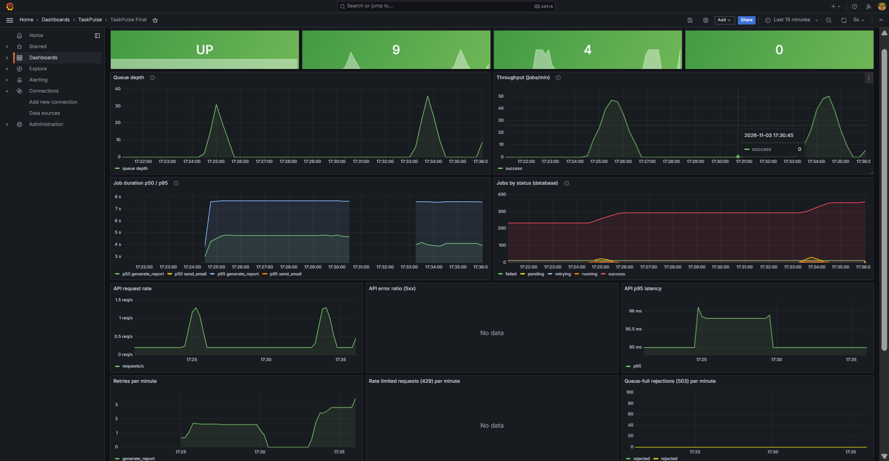
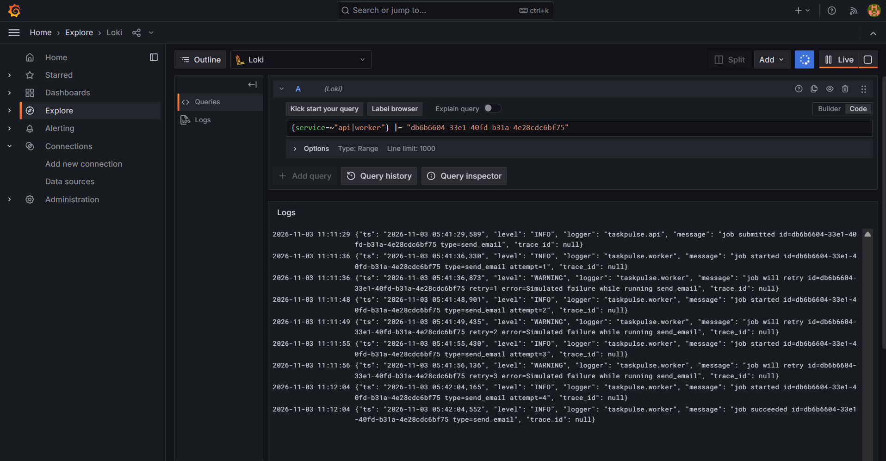
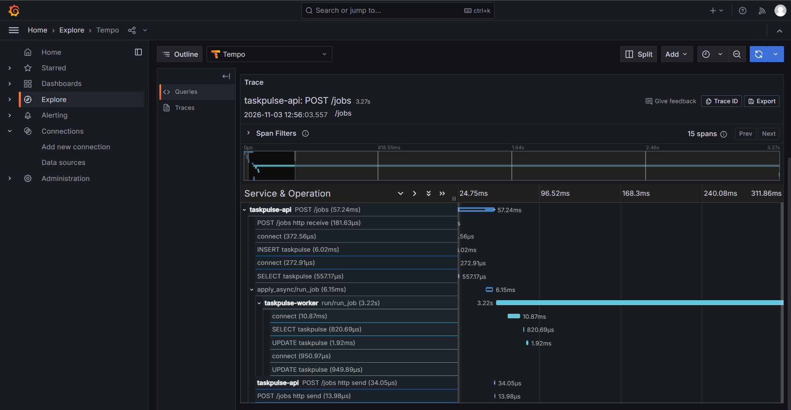
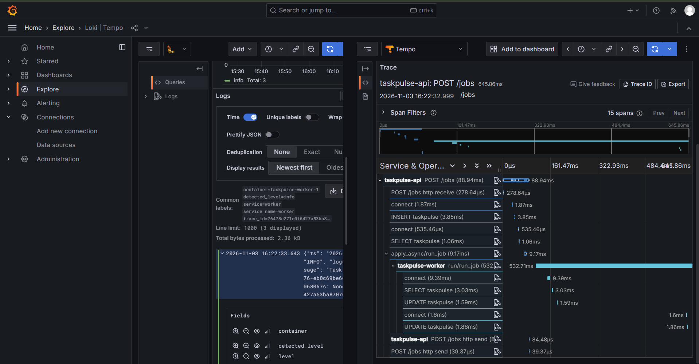
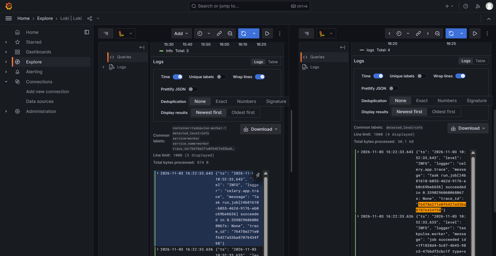
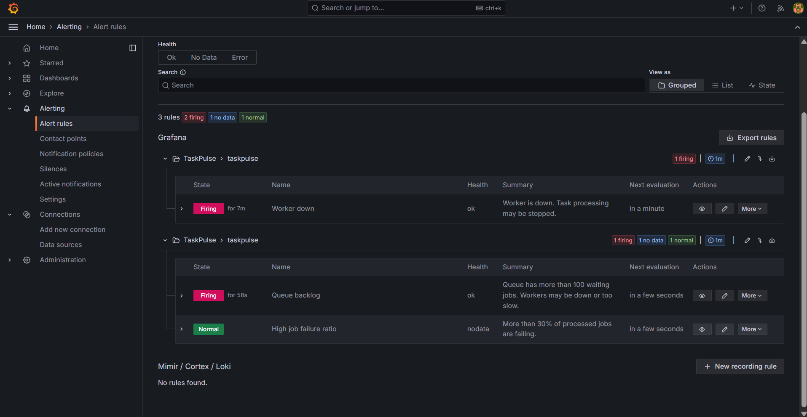

# TaskPulse

Distributed job processing platform with full observability: metrics, logs and traces, linked together in Grafana, with alerting.

## Stack
FastAPI, Celery, Redis, PostgreSQL, Prometheus, Loki, Grafana Alloy, Tempo, OpenTelemetry, Grafana, Docker Compose

## Features
- Submit background jobs over HTTP (202 Accepted)
- Celery workers with retries and exponential backoff (2s, 4s, 8s)
- Job status tracking in PostgreSQL (pending, running, retrying, success, failed)
- Manual retry for failed jobs
- Per-client rate limiting (HTTP 429 with Retry-After)
- Queue backpressure (HTTP 503 when the queue is full)
- Prometheus metrics and a provisioned Grafana dashboard (queue depth, throughput, job duration, errors)
- Structured JSON logs shipped to Loki and searchable in Grafana
- Distributed tracing with OpenTelemetry and Tempo (API, queue, worker and database in one trace)
- Logs and traces linked by trace ID in Grafana, in both directions
- Grafana alert rules for queue backlog, worker down and a high job failure ratio

## Architecture
```
Client --> FastAPI (rate limit, save job) --> Redis queue --> Celery worker
                |                                                  |
                +------------------> PostgreSQL <------------------+

Metrics: API :8000/metrics and worker :8001/metrics --> Prometheus --> Grafana
Logs:    container stdout (JSON) --> Grafana Alloy --> Loki ------> Grafana
Traces:  OpenTelemetry (API and worker) --> Tempo ----------------> Grafana
```

## API
| Method | Endpoint | Purpose |
|---|---|---|
| POST | /jobs | Submit a job (response includes its `trace_id`) |
| GET | /jobs | List jobs, filter by status |
| GET | /jobs/{id} | Job details |
| POST | /jobs/{id}/retry | Retry a failed job |
| GET | /health | Health check |
| GET | /metrics | Prometheus metrics |

Job types: `generate_report`, `send_email`, `resize_image`.

## Rate limits
| Scope | Default | Environment variable |
|---|---|---|
| Submit jobs | 30 per minute per client | `RATE_LIMIT_SUBMIT` |
| Read jobs | 300 per minute per client | `RATE_LIMIT_READ` |
| Retry jobs | 10 per minute per client | `RATE_LIMIT_RETRY` |
| Queue length before HTTP 503 | 500 | `MAX_QUEUE_DEPTH` |

Clients are identified by the `X-API-Key` header, or by IP address if there is no header.
The limiter is a fixed-window counter in Redis. If Redis is down it fails open, so users are not blocked.

## Configuration
Set in `.env` (see `.env.example`).

| Variable | Purpose |
|---|---|
| `RATE_LIMIT_WINDOW_SECONDS` | Length of the rate limit window |
| `TASK_RATE_LIMIT` | Worker throttle, for example `120/m` |
| `FAILURE_RATE` | Share of simulated job failures (for failure testing) |
| `EXTRA_LATENCY_SECONDS` | Extra delay added to every job (for slowness testing) |

## Run
```
copy .env.example .env
docker compose up --build -d
```
(On Mac/Linux use `cp` instead of `copy`.)

Open http://localhost:8000/docs and submit a job.

## Tests
```
docker compose exec api pytest -q
```

## Project structure
```
app/                     FastAPI app, Celery worker, metrics, logging, tracing
tests/                   Automated tests
observability/
  prometheus/            Scrape configuration
  tempo/                 Tempo configuration
  alloy/                 Log collection (Docker logs to Loki)
  grafana/
    provisioning/        Data sources and dashboard provider
    dashboards/          Dashboard JSON, loaded automatically
docs/screenshots/        Images used in this README
docker-compose.yml       All services
```

## Observability

### Metrics
Prometheus scrapes metrics from the API (`:8000/metrics`) and the worker (`:8001/metrics`).
The Grafana dashboard is loaded automatically from `observability/grafana/dashboards/taskpulse.json`.
It shows worker status, queue depth, throughput, job duration (p50 and p95), jobs by status, API request rate, error ratio and latency, retries, rate limited requests, and recent worker warnings.



### Logs
Structured JSON logs are shipped to Loki by Grafana Alloy and searched in Grafana Explore.
This is the full history of one job: submitted, failed three times with exponential backoff, then succeeded.



Useful queries:
```
{service="worker"} | json | level="WARNING"
{service=~"api|worker"} |= "JOB-ID"
```

### Traces
OpenTelemetry traces go to Tempo. One trace follows a job from the API, through the Redis queue, into the worker and the database.
The API answers in under 100 ms while the job runs in the background, and the trace shows where every millisecond went.



To find a trace, copy the `trace_id` from the `POST /jobs` response, open Grafana, go to Explore, choose Tempo, and paste it in the TraceQL tab.

### Logs and traces linked
Every JSON log line carries the `trace_id` of the request it belongs to, and Grafana links the two in both directions.
Click **View trace** on a log line to open its trace:



Click the log icon on a span to see every log line of that trace:



### Alerts
Alert rules are defined in Grafana (Alerting, Alert rules) and evaluated every minute.

| Alert | Query | Condition | Pending |
|---|---|---|---|
| Queue backlog | `max(taskpulse_queue_depth)` | above 100 | 2 min |
| Worker down | `min(up{job="worker"})` | below 1 | 1 min |
| High job failure ratio | `sum(rate(taskpulse_jobs_processed_total{status="failed"}[5m])) / sum(rate(taskpulse_jobs_processed_total[5m]))` | above 0.3 | 2 min |

To test them, stop the worker and send jobs:
```
docker compose stop worker
```
The "Worker down" and "Queue backlog" alerts go from Pending to Firing, and return to Normal after `docker compose start worker`.



### Services
| Service | URL |
|---|---|
| API docs | http://localhost:8000/docs |
| Prometheus | http://localhost:9090 |
| Grafana | http://localhost:3000 (default login `admin` / `admin`, set in `.env`) |
| Loki | http://localhost:3100 |
| Tempo | http://localhost:3200 |

## Roadmap
- Load tests with k6 and failure simulations
- Incident report